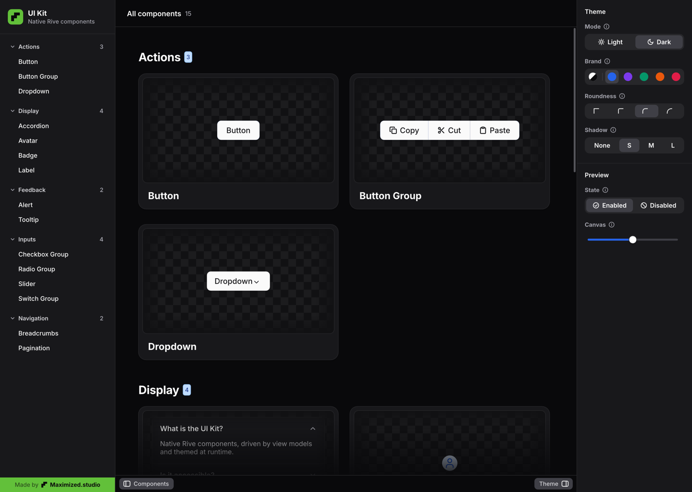

# Rive UI Kit

Native, data-bound UI components for [Rive](https://rive.app), written as text (RML) and built into a `.riv` file. Accessible out of the box, themeable at runtime.

**[▶ Try it live](https://www.maximized.studio/rive/ui-starter-kit)**: switch mode, brand colour, roundness and shadow in your browser.

<a href="https://www.maximized.studio/rive/ui-starter-kit"></a>

The kit is also on the [Rive Community](https://rive.app/community/files/25701-55058/). This repo ships the **Default** theme; more themes will follow.

## Components

- **Actions:** Button · Button Group · Dropdown
- **Display:** Accordion · Avatar · Badge · Label
- **Feedback:** Alert · Tooltip
- **Inputs:** Checkbox / Checkbox Group · Radio Option / Radio Group · Slider · Switch / Switch Group
- **Navigation:** Breadcrumbs · Pagination
- **Building blocks:** Accordion Item · Breadcrumb Item · List Item · Nav Group · Nav Item · Page Item · Segment · Segmented Control · Showcase Section · Sidebar · Slide · Tile · Toolbar · Tooltip Button

Categories and the components in them are sorted A–Z. In the Showcase a category is data: a `ShowcaseSection` (title, tile list; the count is the list length) in `sections`, and a `NavGroup` in the Sidebar's `sections`.

Every component is driven by view models (data binding), not by state machine inputs. The **Theme** panel in the Showcase switches mode (light/dark), brand colour, roundness and shadow at runtime, and previews every component as enabled or disabled.

## Accessibility

The components carry Rive semantics, so screen readers get a real accessibility tree instead of a canvas:

| Component | Role | Exposed |
|---|---|---|
| Accordion | `group` / `button` per item | label; item title, expanded |
| Alert | `group` (live region), `text` | title; body |
| Avatar | `image` | label |
| Badge, Label | `text` | text |
| Breadcrumbs | `group` / `link` per item, `text` for the current page | label; item label, "Current page" |
| Button, Dropdown, Page Item | `button` | label (the page number); Button also a hint |
| Button Group, Checkbox Group, Pagination, Switch Group | `group` | group label |
| Checkbox | `checkbox` | label, checked |
| List Item | `list` / `listItem` | label |
| Radio Option / Radio Group | `radioButton` / `radioGroup` | label, selected |
| Slider | `slider` | label, value |
| Switch | `switchControl` | label, on/off |
| Tooltip | `text` | text (left out when its trigger carries it as a hint) |
| Tooltip Button | `button` | label, hint (the tooltip text) |

Labels are bound to the same view model properties as the visible text, so they stay correct when you change the copy. Check the tree headless:

```bash
rive build/default --semantics=$PWD/build/default.semantics.json
```

## Accordion

A card of collapsible items; several can be open at once.

- View model `Accordion`: `items` (a list of `AccordionItem`), `label` (screen reader name), `a11yHidden`, `theme`.
- `AccordionItem`: `title`, `body`, `open`. Clicking the header (or a screen reader's activate) toggles `open`; the body grows open with a short layout animation and the chevron turns.
- Each header is a `button` that reports expanded or collapsed.

## Breadcrumbs

A trail of links to the pages above the current one: `Home › Components › Navigation`.

- View model `Breadcrumbs`: `items` (a list of `BreadcrumbItem`), `selected` (written when a link is clicked: the item's position, `0` for the first; `-1` until then), `selection` (a shared `BreadcrumbSelection`), `label` (screen reader name), `a11yHidden`, `theme`.
- `BreadcrumbItem`: `label`, `current`, `selection`. Set `current` on the last item: it shows in muted text, is not clickable and is read as the current page. The other items are links that get a soft background on hover, like a button. A separator sits between items, never before the first.
- Point `selection` of every item at the same `BreadcrumbSelection` instance as the `Breadcrumbs` (as with Radio Group). Clicks write it and the component copies the value into `selected`.
- Listen to `selected` in your app to navigate, then replace `items` with the new trail.

## Alert

A card that stays in view with a message in one of four variants. It has no close button; for something the user dismisses, use a dialog.

- View model `Alert`: `title`, `body`, `variant` (`0` info, `1` success, `2` warning, `3` error), `a11yHidden`, `theme`.
- Each variant has its own icon and colours from semantic Theme tokens: info follows the brand colour, success, warning and error have their own light and dark values (see palette.json).
- Hide or show it from your app like any other part of your layout.
- Screen readers get a `group` named by the title and marked as a live region, so a changed title is announced, with the body as text.

## Button Group

A row of kit Buttons joined into one control: the outer corners follow the theme roundness, the inner corners are square, and the group casts one shadow. Primary and secondary Buttons both work and may be mixed.

- View model `ButtonGroup`: `label` (screen reader name), `buttons` (a list of `Button` instances), `a11yHidden`, `theme`.
- Set `group` on every Button in the list: `1` first, `2` middle, `3` last (`0`, the default, is a standalone Button). It rounds only the outer corners and draws a divider before middle and last buttons; secondary borders merge into one line.
- Each Button keeps its own `_pressed` trigger, hover, press ripple and disabled state, so you handle clicks per button as you would for a single Button.

## Pagination

Previous and next Buttons around up to seven page buttons. Set two numbers and the component does the rest.

- View model `Pagination`: `page` (the current page, two-way: clicks write it), `pageCount`, `label` (screen reader name), `a11yHidden`, `theme`.
- Up to seven pages are shown as they are. With more, the row keeps the first and last page and three around the current one, with `…` for the gaps: `1 … 4 5 6 … 20`, `1 2 3 4 5 … 20`, `1 … 16 17 18 19 20`.
- Previous and next step by one and are disabled on the first and last page.
- Listen to `page` in your app to load that page.

## Tooltip

A small bubble in the inverse theme colours (`_text` background, `_bg` text) with a pointer arrow. It fades and scales in when it opens and never blocks pointer input.

- View model `Tooltip`: `text`, `placement` (`0` top, `1` bottom, `2` left, `3` right: the side of the trigger it sits on; the arrow points back at the trigger), `open`, `a11yHidden`, `theme`.
- The Tooltip is the bubble only. Rive has no slots, so the host places it next to its trigger and sets `open`: `enter` and `focus` listeners on the trigger set it, `exit` and `blur` clear it.
- **Tooltip Button** is that pattern, ready to use: a kit Button with a Tooltip. View model `TooltipButton`: `label`, `tooltip`, `placement`, `a11yHidden`, `theme`. Hover or keyboard focus on the Button shows the tooltip.
- In Tooltip Button the bubble sits in an absolute overlay over the trigger, so it never moves the layout. The overlay's direction follows `placement`; an empty mirror box on the far side keeps the trigger in the middle, so all four sides work without measuring anything.
- Screen readers: the Button gets the tooltip text as its `hint` (Button has a new `hint` property) and the bubble is hidden from the tree, so the text is read once. A Tooltip on its own is a `text` node.
- Long text wraps at 240 points.

## Pointer cursor

A canvas can't change the mouse cursor by itself, so the kit tells your app when to. `theme/cursorPointer` (a boolean on the shared Theme view model) is `true` while the pointer is over something clickable: an accordion header, a breadcrumb link, a button, checkbox, dropdown and its items, nav group header, nav item, page item, radio option, segment, slider, switch or tile. Disabled controls leave it `false`. The path below is the Showcase's; in your own artboard it is wherever your view model holds the Theme.

```js
const flag = rive.viewModelInstance.boolean("theme/cursorPointer");
flag.on(() => (canvas.style.cursor = flag.value ? "pointer" : ""));
```

With `@rive-app/react-*`: `useViewModelInstanceBoolean("theme/cursorPointer", rive?.viewModelInstance)` and toggle a `cursor-pointer` class. Use the same flag for a hover pointer on iPad or desktop apps.

## How it is organised

```
shared/            the kit: one .rml file per artboard, 99-_root.rml
                   (view models, assets, interpolators) and image assets
themes/<name>/     only what that theme changes (Default changes nothing)
tools/             Python helpers: retheming, RML generation, splitting
build.sh           assembles and verifies every theme into build/<name>/
```

**Override rule:** a file in `themes/<name>/` with the same filename as one in `shared/` replaces it. Anything else is added. A replacing file keeps the ids of the original, so references from other artboards keep working.

## Build

Requirements: macOS (zsh), Python 3 and the Rive CLI (`rive`, expected at `~/.rive/bin/rive`; override with `RIVE=/path/to/rive`).

```bash
./build.sh                       # build and verify all themes
PREVIEW=1 ./build.sh default     # embeds Inter so text renders in local screenshots
rive build/default --screenshot --advance=2s
```

Do not publish a `PREVIEW` build: an embedded custom font blocks publishing to the Rive Community.

## Make your own theme

1. Create `themes/<name>/palette.json` (format below).
2. Run `PREVIEW=1 ./build.sh <name>` and take a screenshot.
3. Only if a component must change shape: copy its file from `shared/` into `themes/<name>/` and edit it there. Give new objects their own id range (for example `800:*`) so they never collide with shared ids.

### palette.json

```json
{
  "defaults": { "roundness": 2, "shadow": 1 },
  "mode": {
    "Dark":  { "_bg": "#0B0B0F", "_surface": "#16161C", "_border": "#2A2A33", "_text": "#F4F4F5" },
    "Light": { "_bg": "#FAFAFA", "_surface": "#FFFFFF", "_border": "#E4E4E7", "_text": "#18181B" }
  },
  "brands": {
    "Blue": ["#EFF6FF", "#DBEAFE", "#BFDBFE", "#93C5FD", "#60A5FA", "#3B82F6",
             "#2563EB", "#1D4ED8", "#1E40AF", "#1E3A8A", "#172554"]
  }
}
```

- `mode.Light` / `mode.Dark`: surface, border and text tokens (`_bg`, `_surface`, `_surfaceMuted`, `_border`, `_text`, `_textMuted`, …). Any token may be left out.
- Semantic tokens for the Alert: `_successBg`, `_successBorder`, `_successText` and the same for `_warning…` and `_error…` go in `mode.Light` / `mode.Dark`. The `_info…` tokens follow the brand ramp (Light 50/200/700, Dark 950/800/400).
- `brands`: one ramp of 11 steps (50–950) per brand slot (`Blue`, `Violet`, `Emerald`, `Orange`, `Rose`, `Zinc`).
- `defaults` (optional): starting `roundness` and `shadow` (0–3). They are baked into the written values, so the editor canvas and the Community thumbnail show them too.

`tools/retheme.py` turns the palette into the theme's Theme Driver. Known gap: the brand swatches in the Theme panel keep their default colours.

## For maintainers

`./push.sh <theme> "label"` builds a theme and pushes it to its own Rive file (linked in `themes/<theme>/push.yaml`). It refuses to push to the original Community file or to push a `PREVIEW` build. It needs access to the Maximized Studio workspace.

The editor file is the source of truth. After editing in Rive, run `./pull.sh` before committing: it pulls the file read-only, re-splits it into `shared/` and builds.

## License

[MIT](LICENSE) © Maximized Studio. The preview font `preview-assets/Inter.ttf` is licensed under the SIL Open Font License.
